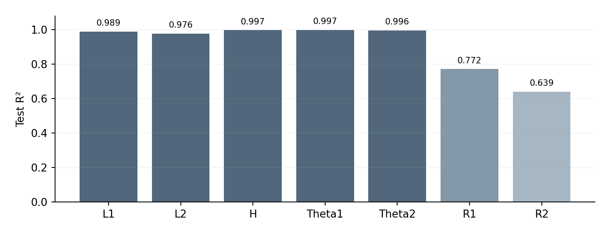

# Engineering & AI Portfolio

**박찬웅 | 서울과학기술대학교 기계공학 전공**  
**관심 분야:** 기계 시스템 설계 · 수치해석 · AI 기반 최적화 · 로봇 행동 학습

기계공학에서 수행한 설계·해석 프로젝트를 바탕으로, **문제를 정의하고 적절한 모델을 선택하며 결과의 의미와 한계를 검토하는 과정**에 관심을 가지고 있습니다. 이 저장소는 KIST GROW Lab 지원을 위한 대표 결과물입니다.

## 대표 프로젝트 — ANN–GA 성형공정 최적 설계

**목표하는 제품 형상에 맞게 금형 설계변수를 어떻게 결정할 것인가?**

Abaqus 기반 제공 데이터에 ANN 대리모델을 학습시키고, 유전알고리즘으로 금형 후보를 탐색했습니다. 단순한 예측 정확도뿐 아니라 목적함수 가중치를 달리했을 때 **어떤 성능을 개선하고 어떤 성능을 양보하는지**를 비교했습니다.

| 프로젝트를 처음 보는 분께 | 바로 열기 |
|---|---|
| **2쪽 프로젝트 요약** — 문제·방법·결과·개인 역할 | [Project Overview (PDF)](ann-ga-hat-forming/Project_Overview.pdf) |
| **전체 Python 노트북** — 코드와 저장된 실행 결과 | [Hat Forming ANN–GA (ipynb)](ann-ga-hat-forming/Hat_Forming_ANN_GA.ipynb) |
| **상세 최종 발표 자료** — 설계·해석·모델 평가 | [Presentation (PDF)](ann-ga-hat-forming/Hat_Forming_ANN_GA_Report.pdf) |
| **프로젝트 설명** — 데이터 흐름과 해석 관점 | [프로젝트 README](ann-ga-hat-forming/README.md) |
| **기계공학 기술 포트폴리오** — CFD, CAD, 제작·설계 | [Portfolio (9쪽 PDF)](portfolio/Portfolio_GROW_Lab.pdf) |

### 결과 요약

- **891개** 성형 사례, **5개 입력 → 7개 출력** ANN 예측
- 학습/검증/독립 시험 분리 후 평가. Test의 높이 `H` R²는 **0.9970**
- 4개 독립 금형변수를 GA로 탐색하고 설계 목표의 가중치 차이를 비교
- 스프링백 우선 대안은 ANN 예측 각도 **0.5379° → 0.1041°**로 낮아졌으나, 높이 오차는 조금 증가

> 이 수치는 기존 과제에 저장된 모델의 **예측 결과**입니다. 새 Abaqus 검증이나 실제 성형 시험 성과를 뜻하지 않습니다.

### 개인 기여

개인 설계 과제로 모델 설정·평가, GA 비교, 결과 해석 및 발표자료 정리를 수행했습니다. Python 코드는 생성형 AI의 도움을 받아 구성하고 결과를 검토했습니다. 자세한 실행 기록은 [노트북](ann-ga-hat-forming/Hat_Forming_ANN_GA.ipynb)에 남아 있습니다.

## 기계공학 프로젝트와 향후 관심

[기술 포트폴리오 PDF](portfolio/Portfolio_GROW_Lab.pdf)에는 DBD 플라즈마 액추에이터 CFD, 태양광 패널 냉각 매니폴드 설계, 광학현미경 차광 커버의 CAD 설계·제작 등 수행 경험을 정리했습니다.

장기적으로는 로터마다 두 축의 추력 방향을 독립적으로 조절할 수 있는 **다자유도 틸트로터 회전익기**를 구상하고 있습니다. 이를 통해 복잡한 기계 구조와 구동 조건을 원하는 동작으로 연결하는 문제에 관심을 갖게 됐습니다. **현재는 개념 구상이며, 비행체 제작이나 로봇 행동 정책 구현 결과는 아닙니다.**

GROW Lab에서는 구조와 환경 조건에 따라 적절한 행동을 결정하고, 학습된 행동을 실제 시스템에서 검증하는 연구과정을 배우고 싶습니다.

---

**자료 안내:** 이 저장소에는 완성된 개인 과제의 원본 노트북과 저장된 실행 결과를 보존했습니다. 재학습에는 수업 제공 CSV가 필요하며, 공개 저장소에는 해당 CSV를 포함하지 않았습니다. 별도의 프로젝트 자료와 수치 검토 기록은 [여기](ann-ga-hat-forming/README.md)에서 확인할 수 있습니다.
