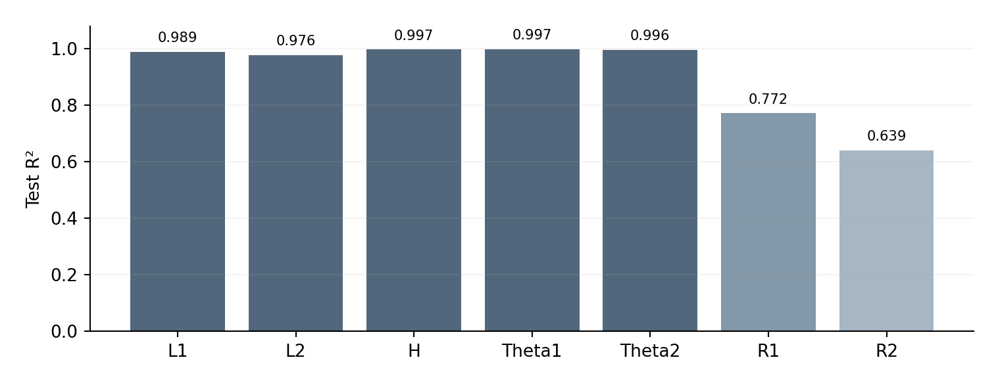
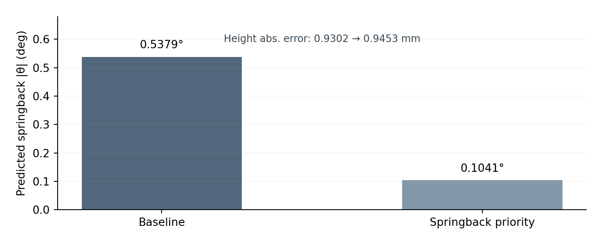

# ANN–GA 기반 Hat 형상 성형공정 최적 설계

**AI 응용제조 개인 설계 과제 | 2026**  
**핵심 주제:** 데이터 기반 성형 형상 예측 · 유전알고리즘 역설계 · 설계 목적함수 민감도

## 먼저 볼 자료

| 자료 | 설명 |
|---|---|
| [프로젝트 2쪽 요약 PDF](Project_Overview.pdf) | 문제, 모델, 성능과 핵심 판단 |
| [전체 Colab Python 노트북](Hat_Forming_ANN_GA.ipynb) | STEP 1~10 소스코드와 저장된 STEP 1~9 실행 출력 |
| [최종 발표 PDF](Hat_Forming_ANN_GA_Report.pdf) | 기하학적 변수, 모델 검토, GA 결과 및 설계 대안 |
| [보고된 수치 CSV](results/reported_test_r2.csv) | 7개 형상변수의 독립 Test R² |
| [금형 대안 비교 CSV](results/reported_design_comparison.csv) | 기준 설계안과 스프링백 우선 설계안의 ANN 예측 비교 |

## 연구 문제와 해결 방법

목표 성형 형상은 주어져 있지만 그 형상을 만들 금형 설계변수는 알려져 있지 않습니다. 일반적인 순방향 해석(금형 → 제품)을 학습한 **ANN 대리모델**과 **유전알고리즘(GA)**을 결합해 금형 후보를 역으로 탐색했습니다.

1. **문제·데이터 정의:** 제공된 891개 Abaqus 기반 사례에서 금형 입력과 성형 후 결과의 관계 정리
2. **ANN 구축·평가:** 입력 5개에서 제품의 7개 형상변수를 예측하는 모델 구성, Train/Validation/Test 분리
3. **GA 설계 탐색:** 금형 특징점으로 구성된 4개 독립 설계변수에 대한 후보 탐색
4. **설계안 비교:** 목적함수 가중치를 변화시키며 스프링백, 높이, 기타 치수 사이의 상충관계 검토

## 주요 결과

- 전체 데이터 **891개**; 학습 **623개**, 검증 **134개**, 독립 시험 **134개**
- 높이 `H`의 Test R² **0.99698**; 반경 `R₂`의 Test R² **0.63928**로 출력별 정확도 차이 확인
- 스프링백 중시 대안은 ANN 예측 스프링백 **0.5379° → 0.1041°**; 그 대신 높이 절대오차는 **0.9302 → 0.9453 mm**

**결론:** 특정 지표가 개선됐다는 사실만으로 전체 설계가 좋아졌다고 단정하기 어렵습니다. 우선 목표와 평가 지표를 명확히 정의한 뒤 대안을 비교해야 한다는 점을 배웠습니다.

## 개인 수행 범위

수업 개인 과제로 ANN 모델 설정·평가, 설계변수 탐색, 목적함수 가중치에 따른 결과 비교 및 발표 자료를 정리했습니다. 코드 작성에는 **생성형 AI의 보조를 활용**했으며, 코드의 실행 결과를 비교하고 연구의 가정·한계를 검토하는 데 집중했습니다.

## 실행·재현성

원본 노트북은 Google Colab 환경을 기준으로 제작됐습니다. 실행하려면 수업 제공 `input.csv`와 `target.csv`를 **Google Drive `MyDrive/`**에 두고, 노트북을 STEP 1부터 순서대로 실행해야 합니다. STEP 5~9는 앞 단계에서 생성한 모델 및 결과 파일이 필요합니다. 환경이 달라지면 재학습된 수치가 당시 저장된 출력과 다를 수 있습니다.

이 공개 저장소에는 수업 제공 원본 CSV를 포함하지 않았습니다. 대신 **완성된 코드, 이전에 저장된 실행 결과, 상세 발표 자료와 수치 요약을 모두 볼 수 있습니다.** 실제 성형품 제작, 신규 Abaqus 해석, CAD 간섭 검증은 이 과제의 수행 범위에 포함되지 않았습니다.

구체적인 원문 대조 사항은 [기술 검토 기록](technical_notes/Source_Audit_Report.md)에 별도로 정리했습니다.
